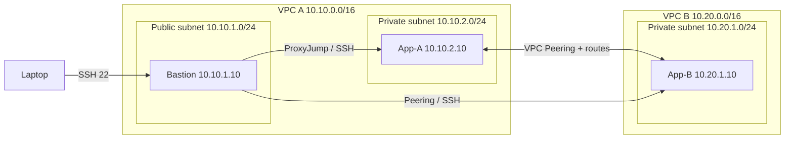

# EWB AWS VPC Peering Lab

Infrastructure-as-Code implementation of the **EWB VPC Peering Student Project** workbook.

It creates two non-overlapping VPCs, three subnets, an internet gateway for VPC A, three route tables, a same-account VPC peering connection, scoped security groups, and three Amazon Linux 2023 EC2 instances (one public bastion and two private workloads).

> **Important:** This repository contains deployable Terraform and test instructions. It does not claim that AWS resources have already been launched or that connectivity tests have passed. Those results must be captured from your own AWS account.

## Architecture



## Prerequisites

- AWS account with permissions for VPC, EC2, security groups, key pairs and route tables.
- AWS CLI configured (`aws configure` or an AWS IAM Identity Center profile).
- Terraform >= 1.6.
- OpenSSH client.
- An SSH **public key**. The private key stays on your laptop and is never uploaded by this project.

## 1. Prepare your SSH key

If you already have an SSH key pair, use its `.pub` file. Otherwise create one:

```bash
ssh-keygen -t ed25519 -f ~/.ssh/ewb-lab
```

This produces `~/.ssh/ewb-lab` (private) and `~/.ssh/ewb-lab.pub` (public). Do not commit either key file.

## 2. Configure Terraform

```bash
cd terraform
cp terraform.tfvars.example terraform.tfvars
```

Edit `terraform.tfvars`:
- Set `region` (default `ap-south-1`, Mumbai).
- Set `admin_cidr` to your current public IPv4 followed by `/32` (for example `203.0.113.10/32`; replace this documentation example).
- Set `public_key_path` to the path of your public key file.
- Optionally set `student_name`.

Do not use `0.0.0.0/0` for SSH ingress.

## 3. Deploy

```bash
terraform init
terraform fmt -check
terraform validate
terraform plan
terraform apply
```

Review the plan and estimated charges before approving. The lab creates billable EC2 instances, EBS volumes and a public IPv4 address. No NAT gateway is created.

After apply, note the Terraform outputs, especially `bastion_public_ip`.

## 4. Connect through the bastion

Generate an SSH config using the output IP, or copy the template below and replace `BASTION_PUBLIC_IP`.

```sshconfig
Host ewb-bastion
    HostName BASTION_PUBLIC_IP
    User ec2-user
    IdentityFile ~/.ssh/ewb-lab
    IdentitiesOnly yes

Host ewb-app-a
    HostName 10.10.2.10
    User ec2-user
    IdentityFile ~/.ssh/ewb-lab
    IdentitiesOnly yes
    ProxyJump ewb-bastion

Host ewb-app-b
    HostName 10.20.1.10
    User ec2-user
    IdentityFile ~/.ssh/ewb-lab
    IdentitiesOnly yes
    ProxyJump ewb-bastion
```

Save it to `~/.ssh/config`, then:

```bash
chmod 600 ~/.ssh/config
chmod 400 ~/.ssh/ewb-lab
ssh ewb-bastion
ssh ewb-app-a
ssh ewb-app-b
```

The private key must remain on your laptop. `ProxyJump` opens a separate SSH connection from the bastion to the private destination.

## 5. Validate connectivity

Before peering is active, the workbook expects App-A's ping to App-B to fail. Terraform creates and activates peering and the required routes as part of deployment, so if you need to demonstrate the **before** state, capture it during a staged/manual build before adding peering routes.

After deployment:

```bash
# From App-A
ping -c 4 10.20.1.10

# From App-B
ping -c 4 10.10.2.10

# From your laptop: SSH to App-B through the bastion
ssh ewb-app-b
```

On each private host, record identity and address:

```bash
hostname
hostname -I
```

Expected acceptance criteria from the workbook: four ping replies in each direction with 0% packet loss; App-B SSH succeeds through the bastion; neither private instance has a public IPv4 address.

### Controlled failure test

In the AWS console, temporarily remove only the `ICMP` Echo Request inbound rule from `ewb-sg-app-b` whose source is `10.10.2.10/32`. Repeat the App-A ping; it should fail. Restore the exact rule and repeat; it should succeed. Keep the SSH rule in place. Capture screenshots of the rule change and terminal results.

## 6. Explain the design

- The VPC CIDRs `10.10.0.0/16` and `10.20.0.0/16` do not overlap.
- The VPC peering connection provides a private link, but route tables must direct traffic to the peering connection on both sides.
- The public subnet route table needs a route to `10.20.0.0/16` because the bastion initiates SSH to App-B through `ProxyJump`.
- App-B's SSH source is the bastion private address (`10.10.1.10`), not the laptop's public address.
- Security groups are stateful. The lab permits only the specified SSH and ICMP sources.
- VPC peering is non-transitive and does not give VPC B internet access through VPC A's internet gateway.

## 7. Cleanup (avoid ongoing charges)

Save evidence first, then run:

```bash
cd terraform
terraform destroy
```

Review the destroy plan and confirm. Check the AWS console for leftover lab volumes, snapshots or public IPv4 allocations. Terraform state files may contain infrastructure metadata; do not commit them.

## Repository contents

```text
.
├── README.md
├── .gitignore
├── LICENSE
├── terraform/
│   ├── versions.tf
│   ├── variables.tf
│   ├── main.tf
│   ├── outputs.tf
│   └── terraform.tfvars.example
└── scripts/
    └── verify-connectivity.sh
```

## Push to GitHub

Create an empty repository on GitHub named `ewb-aws-vpc-peering`, then from this folder run:

```bash
git init
git add .
git commit -m "Add EWB AWS VPC peering lab"
git branch -M main
git remote add origin https://github.com/YOUR_GITHUB_USERNAME/ewb-aws-vpc-peering.git
git push -u origin main
```

Never commit `terraform.tfvars`, `.pem` files, private keys, `.tfstate` files or AWS credentials.
